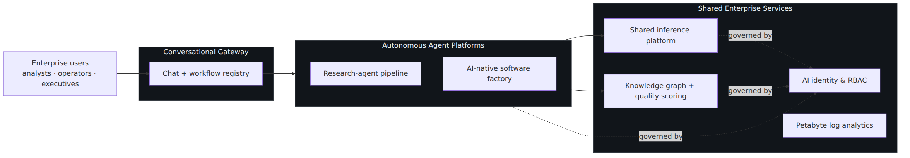

# Sachidananda Karkala

**Enterprise AI Platform Architect** — I design the platforms organisations run AI on, and then I build them.

Governed, auditable, cost-aware AI: shared inference, autonomous multi-agent systems, knowledge you can measure, and the identity layer that holds it all together.

| 7 | 7 | 3 | 3 |
|:---:|:---:|:---:|:---:|
| **systems built in 2026** | **enterprise reference architectures** | **clouds in production** — AWS · Google Cloud · Vercel | **languages** — TypeScript · Python · Rust |

---

## The problems I work on

| When an organisation says… | I design and build… | See it in |
|---|---|---|
| *"Every team runs its own AI pilot, its own GPUs, its own security posture."* | One governed inference platform — identity at the edge, an AI firewall, cost attributed per user. | [Shared Inference Platform](architectures/shared-inference-platform.md) |
| *"Our agents can act now. Nobody can say what they are allowed to do."* | Per-tool access control, a guardian over every agent loop, and an audit trail for every decision. | [AI Identity & Access](architectures/identity-access.md) · [Anvaya](builds/anvaya.md) |
| *"The AI sounds right, but we can't trust it."* | Knowledge that scores its own quality, cited answers, and deterministic checks under every model call. | [Knowledge Layer](architectures/knowledge-layer.md) · [VeriClaims AI](builds/vericlaims.md) |
| *"AI should support our people's judgement, not replace it."* | AI that is advisory by privilege boundary — it cannot write the final decision, by design. | [Hackathon Judging Platform](builds/hackathon-judging.md) · [Usra](builds/usra.md) |
| *"We serve many customers on one platform, and it has outgrown its database."* | Multi-tenant isolation with server-side roles, and live migrations without a big-bang cutover. | [TribeRoots](builds/triberoots.md) · [Vouch](builds/vouch.md) |
| *"Our data volumes broke the platform and the budget."* | Tiered, compressed analytics with cross-region recovery at hundreds of billions of events a month. | [Petabyte-Scale Observability](architectures/observability.md) |

---

## Built & Shipped

Working systems, not slideware — from live products to deployed platforms and hackathon MVPs. Each links to a full case study with its architecture.

### [VeriClaims AI](builds/vericlaims.md) — verification that can't be faked
🏆 **Winner, [SuperAI 2026 NEXT Hackathon](https://lnkd.in/p/gCCipJW7)**

An agent swarm decides returns, insurance cover and claims on evidence instead of trust. Video is sealed on the device with a hash chain and signature; integrity is always a cryptographic verdict, never an LLM's opinion. A second swarm researches new fraud tactics every night.
`Claude vision` `AWS Bedrock AgentCore` `Vercel Workflows` `DynamoDB` · **[Live app](https://vericlaims.vercel.app)** · **[Demo video](https://youtu.be/UMt70Mh64fQ)**

### [Anvaya](builds/anvaya.md) — a governed multi-agent system for family finances
An AI companion that helps families find what a loved one left behind. Fifteen agents run inside budgets behind one gateway; a guardian watches every loop; nothing is released without two human reviewers. 803 automated tests, and 7 of 7 forged certificates caught on the evaluation set.
`Gemini` `Google ADK` `Cloud Run` `Cloud KMS` · **[Try the app](https://anvaya-saathi.web.app)** · **[Admin portal](https://anvaya-admin.web.app)**

### [Vouch](builds/vouch.md) — trust enforced by the database, not the code
A professional network where standing comes only from records other people signed. Self-endorsement is impossible at the schema level, and history cannot be rewritten. Specification-first testing found 21 defects before users did; one query went from 531 ms to 1.2 ms.
`Rust` `PostgreSQL` `AWS Lambda` `Aurora Serverless v2` · Invitation only

### [Hackathon Judging Platform](builds/hackathon-judging.md) — AI that advises, people who decide
Ran live through an overnight public hackathon: 32 teams, 116 builders, 10 judges. Claude produced an evidence-backed read of each submission, but held no permission to write a score — and abstained where it could not see the evidence. Hardened against prompt injection from the code it was judging.
`Next.js` `Claude structured output` `Neon Postgres` `Vercel Workflow` · Event concluded

### [TribeRoots](builds/triberoots.md) — one platform, many private communities
A multi-tenant community platform with three tiers of administration enforced on the server. Migrated live from Firestore to Postgres one entity at a time, with the app green throughout; payments run on an idempotent ledger with signed tickets.
`React 19` `Neon Postgres` `Firebase Auth` `Playwright` · Private communities

### [Usra](builds/usra.md) — privacy-first AI for the whole household
A digital twin that helps a family find balance — with no cameras, no recordings and no individual scores. Every AI suggestion passes fixed rules, an AI reviewer, then people, and each check can only be stricter than the last.
`Claude` `Vercel Workflow` `Neon Postgres` `JSON Schema contracts` · Prototype

### [InsideEdge](builds/insidedge.md) — an AI-authored TV channel for every office
An always-on lobby channel for a company with 60+ offices, composed live by a crew of agents — reporters, an editor per office, a producer and a gatekeeper — in each office's own language. Employee posts go on air in under 90 seconds; hard rules run in code, the safety check runs in parallel with rendering, and a person can override or kill any segment in seconds.
`Claude structured output` `FastAPI` `VideoDB` `hls.js` · Hackathon MVP

---

## How I design

Six principles run through every system above.

1. **Put trust where it can't be forgotten.** Enforce rules in the database, in cryptography and in permissions — not in prompts or the UI. *([Vouch](builds/vouch.md), [VeriClaims AI](builds/vericlaims.md))*
2. **AI proposes, people decide.** Human approval is a structural gate, not a checkbox. *([Anvaya](builds/anvaya.md), [Hackathon Judging](builds/hackathon-judging.md), [InsideEdge](builds/insidedge.md))*
3. **A deterministic floor under every agent.** If the model skips a step, code fills it; the agentic result is never worse than the rule-based one. *([VeriClaims AI](builds/vericlaims.md))*
4. **Measure knowledge before you use it.** Score it, cite it, and let systems refuse low-confidence work. *([Knowledge Layer](architectures/knowledge-layer.md))*
5. **Centralise the platform, keep the edges pluggable.** One identity, one gateway, one cost centre — swappable models and workflows. *([Shared Inference](architectures/shared-inference-platform.md), [Conversational Gateway](architectures/conversational-gateway.md))*
6. **Say what isn't built.** Known gaps are written down as specifications, and AI abstains where it lacks evidence. *([Vouch](builds/vouch.md), [Hackathon Judging](builds/hackathon-judging.md))*

---

## Reference Architectures

How the pieces compose at enterprise scale: one substrate, three product lines, and a single identity layer across every tier.

| Architecture | The problem it solves |
|---|---|
| [Autonomous Research-Agent Platform](architectures/research-agent-platform.md) | Turns a customer brief into a cited, reviewed deliverable — the analyst becomes the editor. |
| [Shared Enterprise Inference Platform](architectures/shared-inference-platform.md) | Replaces per-team GPU sprawl with one governed, cost-attributed endpoint. |
| [AI-Native Software Delivery Factory](architectures/software-factory.md) | Takes a business epic to a governed deployment through specialised agents and human approval. |
| [Enterprise Knowledge Layer](architectures/knowledge-layer.md) | Gives RAG a trust signal — every topic carries a measured quality score. |
| [AI Identity & Access](architectures/identity-access.md) | Per-tool, per-role authorisation for agents, reusable across platforms. |
| [Conversational Gateway](architectures/conversational-gateway.md) | One chat surface for conversation and sanctioned automations. |
| [Petabyte-Scale Observability](architectures/observability.md) | Log analytics at ~800 billion events a month, with tiered storage and DR. |

---

## Toolbox

| | |
|---|---|
| **AI & agents** | Claude · Gemini · AWS Bedrock AgentCore · Google ADK · multi-agent orchestration · structured output · evaluation design · prompt-injection defence |
| **Platform & cloud** | AWS (Lambda, Aurora, DynamoDB, CDK) · Google Cloud (Cloud Run, Firestore, KMS) · Vercel (Functions, Workflow) · Kubernetes · Argo CD / GitOps |
| **Data** | PostgreSQL · Neon · DynamoDB · knowledge graphs · columnar analytics · tiered storage |
| **Security & identity** | OIDC / SSO · RBAC · row-level security · Ed25519 / ECDSA signing · HMAC · audit trails |
| **Engineering** | TypeScript · Python · Rust · React · Next.js · contract-first APIs · Playwright · CI/CD |

---

## Get in touch

Always glad to talk about AI platforms, governed agents, or a system that needs to be designed — and built.

**Email:** sachi.achar@gmail.com
