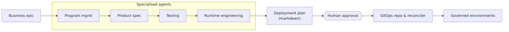
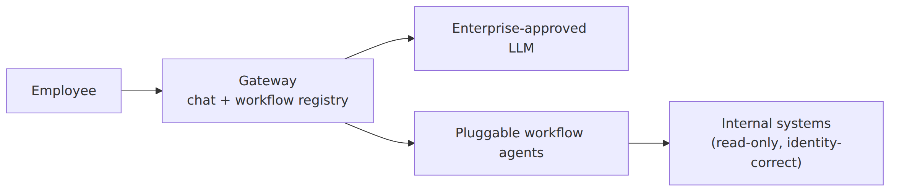
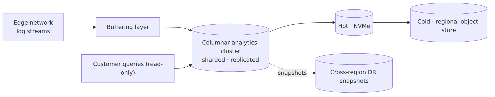

# Sachidananda Karkala

**Enterprise AI Platform Architecture**

Designing the platforms enterprises run AI on — shared inference, autonomous multi-agent systems, knowledge governance, and the identity and change-management glue that makes them work.

---

## Overview

I work on how enterprises move from **ad-hoc AI pilots** to **governed, shared AI platforms** — the kind that have one security perimeter, one cost centre, one knowledge store, and measurable quality gates.

The throughline is platform thinking: where to centralise (inference, identity, knowledge, change management) and where to keep things pluggable (model backends, workflow agents, downstream tools).

---

## Core Competencies

### Shared AI Inference
One governed endpoint replacing per-team GPU sprawl. OIDC at the perimeter, swappable backend, cost attribution by user.

### Autonomous Agents
Multi-agent pipelines with Plan / Execute / Evaluate / Replan loops, stakeholder-perspective review, and human-in-the-loop gates on quality.

### AI Identity & RBAC
Per-tool access control for AI agents, reusable across services. Auditable, role-inheriting, and built to integrate with any IdP.

### Data & Knowledge Platforms
Petabyte-scale log analytics, temporal knowledge graphs, and measurable knowledge quality with hallucination penalties.

---

## How the Platforms Compose

### One substrate, three product lines

An **autonomous research-agent platform** designed to produce structured analysis end-to-end. A **shared inference cluster** designed to give every team and every agent a governed, cost-attributed model endpoint. A **software factory** where program managers, product specialists, QA, and platform engineers are agents composing end-to-end deployments.

All three run on shared enterprise services: a knowledge graph that scores its own quality, an identity layer that's pluggable and audit-friendly, and a petabyte-scale data platform.

---

## Reference Architectures

### 1. Autonomous Research-Agent Platform

**Multi-agent · Governance · GitOps**

Reference architecture for a governed multi-agent platform that takes a customer brief end-to-end — research, analysis, stakeholder-perspective review, and presentation-ready output.

#### The Enterprise Problem
Consulting and customer-success teams spend disproportionate effort preparing structured reviews — the analysis is repetitive but the stakes are high, the data is scattered, and quality varies wildly between analysts.

#### Architectural Approach
A **Plan → Execute → Evaluate → Replan** loop driven by a durable workflow runtime. Agents are stateless and composable; all state lives in shared services (a temporal knowledge graph, RBAC, audit logging).

Quality is treated as a first-class signal. Before deeper analysis runs, the planner reads a per-topic confidence score; topics that fall below threshold trigger a **human-in-the-loop gap-fill**.

#### Design Outcomes
- **End-to-end automation** from raw inputs to executive-ready deliverable — analyst becomes editor, not author
- **Stakeholder-perspective review** built in — security and operations critique runs before content reaches a customer
- **Knowledge-quality gating** — the platform refuses to opine on topics it doesn't understand well enough; humans approve any gap-fill
- **Cited findings** — every conclusion traceable to a graph entity, eliminating "the LLM said so" risk
- **GitOps change control** — every platform change is a reviewable pull request; rollback is one commit away
- **Pluggable models** — analytical vs mechanical work routed to different tiers; private data never leaves the cluster

**Stack:** Multi-agent orchestration · Durable workflow runtime · Knowledge graph · GitOps / Argo CD · Kubernetes

---

### 2. Shared Enterprise Inference Platform

**AI Platform · Cost Governance · Security**

Reference architecture for a centrally managed AI inference platform — replacing per-team GPU sprawl with one governed endpoint designed for global use across demos, proofs-of-concept, and production workloads.

#### The Enterprise Problem
Teams provision their own GPU instances. Most sit idle. Different teams run different model versions with different configurations — demos to customers stop being reproducible. Each ad-hoc setup has its own security posture.

#### Architectural Approach
A single always-on inference endpoint, secured by an **OIDC perimeter** and protected by an **AI-specific firewall** (prompt injection, exfiltration, jailbreak detection).

Releases are guarded by automated capacity validation: a deployment is blocked before it lands if it would exceed safe GPU memory. Every request is attributed to a user at the perimeter, so usage is always cost-attributable and auditable.

#### Design Outcomes
- **One endpoint, one security boundary, one cost centre** — replacing fragmented per-team setups
- **Democratised access to large models** — 30B+ parameter models reachable by any authorised user without per-team infrastructure overhead
- **AI-perimeter security** — prompt-injection and exfiltration filtering before requests consume GPU capacity
- **Per-user cost attribution** — usage tied to identity at the edge, enabling showback and chargeback
- **Backend independence** — model runtime can be swapped without client-side changes
- **Safe by default** — deployments blocked automatically if they would over-commit GPU memory

**Stack:** Enterprise AI platform · OIDC / SSO · AI security perimeter · GPU capacity governance · Kubernetes

---

### 3. AI-Native Software Delivery Factory

**AI SDLC · GitOps · Approval Gates**

Proof-of-concept design for a multi-agent "software factory" — program management, product specification, testing, and runtime engineering each as a specialised agent, communicating over a shared bus.

#### The Enterprise Problem
AI coding assistants are individual-productivity tools. The harder problem — turning a business epic into a deployed, governed application — still requires several specialist roles (product owner, QA lead, platform engineer, program manager).

#### Architectural Approach
Each role is its own agent, isolated to its own prompt and container, communicating over a shared message bus. A **dashboard** is the operator surface; the runtime-engineering agent serves as the orchestrator.

The agent runtime is shared and pluggable: any agent can use a cloud-hosted model or a self-hosted one per environment, with full request tracing for audit. New agent roles are configuration + prompt, not code.

#### Design Outcomes
- **Role separation by design** — program, product, test, and platform concerns each owned by a specialised agent
- **Approval-gated releases** — nothing reaches the cluster without an explicit human decision
- **GitOps as the audit trail** — every deployment is a reviewable commit; rollback is a revert
- **Per-environment model choice** — cloud models in dev, fully self-hosted in regulated environments
- **Full request tracing** — every agent call is observable end-to-end for compliance and debugging
- **Configuration over code** — adding a new role agent is a prompt + an entry, not a new codebase

**Stack:** Multi-agent SDLC · GitOps / Argo CD · Approval gates · Distributed tracing · Kubernetes

---

### 4. Enterprise Knowledge Layer with Measurable Quality

**Knowledge Graph · Trust · RBAC**

Reference architecture for a temporal knowledge graph over enterprise content — product documentation, customer engagement history, analytical findings — that scores its own knowledge quality.

#### The Enterprise Problem
RAG over an enterprise corpus produces fluent answers that no one can trust. There is no signal for "is this graph good enough to use for this customer, this topic, this question?"

#### Architectural Approach
A temporal knowledge graph stores entities and relationships extracted from source documents, namespaced per domain. After every ingest, the platform runs **three probe passes**: factual consistency checks, relational integrity, and negative-fact detection (things the model should have learned but didn't).

That score is the input to other systems' trust decisions: the autonomous agent platform reads it before deciding whether to plan analysis on a topic. Access is governed by per-tool RBAC: analysts read, ingestion pipelines write, platform engineers evaluate and delete.

#### Design Outcomes
- **Measurable knowledge quality** — every topic carries a score; downstream agents can refuse low-confidence work
- **Hallucination-aware scoring** — explicit penalty when the model invents facts under retrieval
- **Per-tool RBAC** — three role tiers control who can query, ingest, or evaluate
- **Standard IdP integration** — JWT-based, drops into any enterprise SSO setup
- **Temporal model** — facts are time-aware, so "what did we know about this customer last quarter?" is a first-class query
- **Two surfaces, one core** — programmatic and human UIs over the same governed store

**Stack:** Knowledge graph · Hallucination scoring · RBAC & JWT · Temporal model · Kubernetes

---

### 5. AI Identity & Access for Tool-Using Agents

**Identity · Per-Tool RBAC · Drop-In**

Reference architecture for a reusable identity and per-tool access-control layer for AI agent platforms — designed to drop into any agent backend, governed by the same IdP an enterprise already uses.

#### The Enterprise Problem
AI agents expose tools. Analysts should only be able to read; ingestion pipelines should be able to write; only platform engineers should be able to evaluate or delete. A single shared key is a liability.

#### Architectural Approach
Two artefacts. A **self-hosted IdP** deployment that issues tokens, manages users and roles, and provides an audit UI for ops. A **pluggable access-control library** that agents embed and call on every tool invocation, with microsecond-latency authorisation and full audit trails.

#### Design Outcomes
- **Per-tool, per-role authorisation** — different callers see different surfaces of the same agent
- **One identity layer across multiple agent platforms** — same tokens, same roles, same audit trail
- **Microsecond authorisation** — no network hop on the hot path
- **Role inheritance** — policies grow linearly, not combinatorially
- **IdP-agnostic** — bring your own SSO or use the bundled one
- **Auditable by design** — every authorisation decision is loggable and explainable

**Stack:** AI identity layer · Per-tool RBAC · Role inheritance · SSO-agnostic · Kubernetes

---

### 6. Conversational Gateway for Organisational Automation

**AI Gateway · Automation Surface**

Architectural design for a single chat surface where employees talk things through with an assistant and run company-defined automations — every automation a pluggable workflow agent.

#### The Enterprise Problem
Public AI chat tools are great for conversation but can't kick off internal actions and don't know about private systems. Internal automation scripts exist but are scattered across wikis, runbooks, and Slack threads.

#### Architectural Approach
A gateway with two modes. The **default mode** is a standard chat assistant pointed at an enterprise-approved upstream model. The **workflow registry** holds automations: each is a named agent endpoint, invoked by natural language from chat.

External access to sensitive systems is locked to a read-only allowlist with identity-correct context resolution, so the gateway can never be tricked into acting on the wrong customer account or running unapproved code.

#### Design Outcomes
- **One surface for chat + sanctioned automations** — replacing tool sprawl with a governed gateway
- **Pluggable workflows** — platform teams add or retire automations without redeploying the gateway
- **Industry-standard API** — any client that speaks the standard LLM protocol drops in
- **Identity-correct external access** — read-only, with a resolver that refuses ambiguous customer context
- **Deploy anywhere** — runs on a laptop for dev, scales to a shared service for a department
- **Observable by default** — every run carries an audit trail

**Stack:** AI gateway · Pluggable workflows · Read-only safe access · Standard LLM protocol · Kubernetes

---

### 7. Petabyte-Scale Observability — Reference Architecture

**Data Platform · Tiered Storage · DR**

Reference architecture for a log analytics platform designed to handle **~800 billion events per month** — columnar storage, tiered hot/cold/backup, and cross-region disaster recovery.

#### The Enterprise Problem
At edge-network scale, log volumes break general-purpose data stores and bankrupt naïve storage strategies. Customers need queryable history but the cost curve grows linearly with raw volume unless you're ruthless about compression and tiering.

#### Architectural Approach
Columnar storage with **10–12× compression**, sharded for parallel ingest and query, with a **tiered storage model**: hot tier on local NVMe for recent data, cold tier in regional object storage for history, and cross-region snapshots for DR.

#### Design Outcomes
- **~800B events / month** as design target, with multi-x burst capacity headroom
- **10–12× compression** — economics that make full-history retention viable
- **Tiered hot / cold / DR** — recent data fast, history affordable, disaster recovery cross-region
- **Ingest / query isolation** — customer queries unaffected by ingestion spikes
- **Improved RPO via cross-region snapshots** — measured in hours, not days
- **Documented operations** — runbooks for DR, upgrades, credential rotation, troubleshooting

**Stack:** Columnar analytics · Tiered storage · Cross-region DR · Kubernetes

---

## Contact

**Email:** sachi.achar@gmail.com

---

*Sachidananda Karkala · Enterprise AI Platform Architecture*
