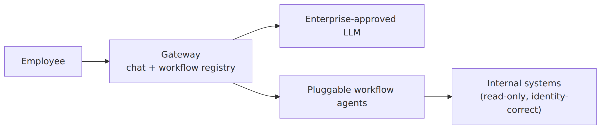

[← Back to portfolio](../README.md) · Reference Architectures

# Conversational Gateway for Organisational Automation

**AI Gateway · Automation Surface**

Architectural design for a single chat surface where employees talk things through with an assistant and run company-defined automations — every automation a pluggable workflow agent.

## The Enterprise Problem
Public AI chat tools are great for conversation but can't kick off internal actions and don't know about private systems. Internal automation scripts exist but are scattered across wikis, runbooks, and Slack threads.

## Architectural Approach
A gateway with two modes. The **default mode** is a standard chat assistant pointed at an enterprise-approved upstream model. The **workflow registry** holds automations: each is a named agent endpoint, invoked by natural language from chat.

External access to sensitive systems is locked to a read-only allowlist with identity-correct context resolution, so the gateway can never be tricked into acting on the wrong customer account or running unapproved code.

## Design Outcomes
- **One surface for chat + sanctioned automations** — replacing tool sprawl with a governed gateway
- **Pluggable workflows** — platform teams add or retire automations without redeploying the gateway
- **Industry-standard API** — any client that speaks the standard LLM protocol drops in
- **Identity-correct external access** — read-only, with a resolver that refuses ambiguous customer context
- **Deploy anywhere** — runs on a laptop for dev, scales to a shared service for a department
- **Observable by default** — every run carries an audit trail

**Stack:** AI gateway · Pluggable workflows · Read-only safe access · Standard LLM protocol · Kubernetes

---

← [AI Identity & Access for Tool-Using Agents](identity-access.md) · [Home](../README.md) · [Petabyte-Scale Observability](observability.md) →
