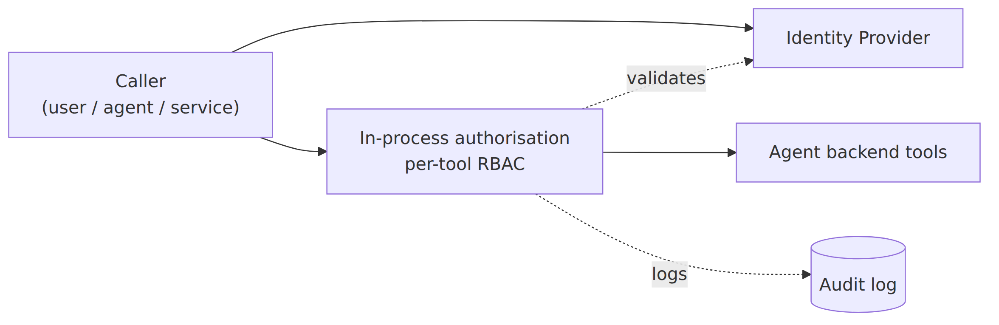

[← Back to portfolio](../README.md) · Reference Architectures

# AI Identity & Access for Tool-Using Agents

**Identity · Per-Tool RBAC · Drop-In**

Reference architecture for a reusable identity and per-tool access-control layer for AI agent platforms — designed to drop into any agent backend, governed by the same IdP an enterprise already uses.

## The Enterprise Problem
AI agents expose tools. Analysts should only be able to read; ingestion pipelines should be able to write; only platform engineers should be able to evaluate or delete. A single shared key is a liability.

## Architectural Approach
Two artefacts. A **self-hosted IdP** deployment that issues tokens, manages users and roles, and provides an audit UI for ops. A **pluggable access-control library** that agents embed and call on every tool invocation, with microsecond-latency authorisation and full audit trails.

## Design Outcomes
- **Per-tool, per-role authorisation** — different callers see different surfaces of the same agent
- **One identity layer across multiple agent platforms** — same tokens, same roles, same audit trail
- **Microsecond authorisation** — no network hop on the hot path
- **Role inheritance** — policies grow linearly, not combinatorially
- **IdP-agnostic** — bring your own SSO or use the bundled one
- **Auditable by design** — every authorisation decision is loggable and explainable

**Stack:** AI identity layer · Per-tool RBAC · Role inheritance · SSO-agnostic · Kubernetes

---

← [Enterprise Knowledge Layer with Measurable Quality](knowledge-layer.md) · [Home](../README.md) · [Conversational Gateway for Organisational Automation](conversational-gateway.md) →
