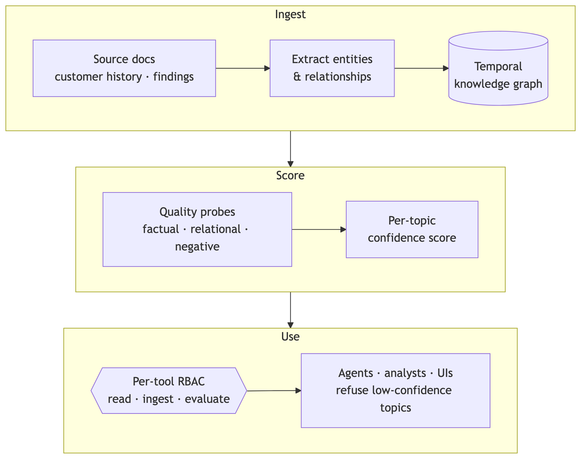

[← Back to portfolio](../README.md) · Reference Architectures

# Enterprise Knowledge Layer with Measurable Quality

**Knowledge Graph · Trust · RBAC**

Reference architecture for a temporal knowledge graph over enterprise content — product documentation, customer engagement history, analytical findings — that scores its own knowledge quality.

## The Enterprise Problem
RAG over an enterprise corpus produces fluent answers that no one can trust. There is no signal for "is this graph good enough to use for this customer, this topic, this question?"

## Architectural Approach
A temporal knowledge graph stores entities and relationships extracted from source documents, namespaced per domain. After every ingest, the platform runs **three probe passes**: factual consistency checks, relational integrity, and negative-fact detection (things the model should have learned but didn't).

That score is the input to other systems' trust decisions: the autonomous agent platform reads it before deciding whether to plan analysis on a topic. Access is governed by per-tool RBAC: analysts read, ingestion pipelines write, platform engineers evaluate and delete.

## Design Outcomes
- **Measurable knowledge quality** — every topic carries a score; downstream agents can refuse low-confidence work
- **Hallucination-aware scoring** — explicit penalty when the model invents facts under retrieval
- **Per-tool RBAC** — three role tiers control who can query, ingest, or evaluate
- **Standard IdP integration** — JWT-based, drops into any enterprise SSO setup
- **Temporal model** — facts are time-aware, so "what did we know about this customer last quarter?" is a first-class query
- **Two surfaces, one core** — programmatic and human UIs over the same governed store

**Stack:** Knowledge graph · Hallucination scoring · RBAC & JWT · Temporal model · Kubernetes

---

← [AI-Native Software Delivery Factory](software-factory.md) · [Home](../README.md) · [AI Identity & Access for Tool-Using Agents](identity-access.md) →
