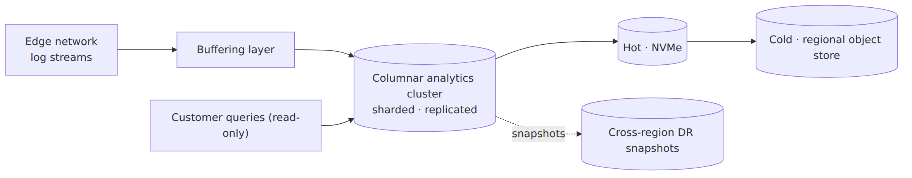

[← Back to portfolio](../README.md) · Reference Architectures

# Petabyte-Scale Observability

**Data Platform · Tiered Storage · DR**

Reference architecture for a log analytics platform designed to handle **~800 billion events per month** — columnar storage, tiered hot/cold/backup, and cross-region disaster recovery.

## The Enterprise Problem
At edge-network scale, log volumes break general-purpose data stores and bankrupt naïve storage strategies. Customers need queryable history but the cost curve grows linearly with raw volume unless you're ruthless about compression and tiering.

## Architectural Approach
Columnar storage with **10–12× compression**, sharded for parallel ingest and query, with a **tiered storage model**: hot tier on local NVMe for recent data, cold tier in regional object storage for history, and cross-region snapshots for DR.

## Design Outcomes
- **~800B events / month** as design target, with multi-x burst capacity headroom
- **10–12× compression** — economics that make full-history retention viable
- **Tiered hot / cold / DR** — recent data fast, history affordable, disaster recovery cross-region
- **Ingest / query isolation** — customer queries unaffected by ingestion spikes
- **Improved RPO via cross-region snapshots** — measured in hours, not days
- **Documented operations** — runbooks for DR, upgrades, credential rotation, troubleshooting

**Stack:** Columnar analytics · Tiered storage · Cross-region DR · Kubernetes

---

← [Conversational Gateway for Organisational Automation](conversational-gateway.md) · [Home](../README.md)
