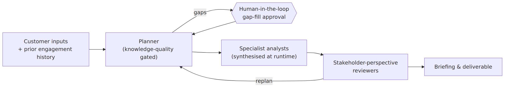

[← Back to portfolio](../README.md) · Reference Architectures

# Autonomous Research-Agent Platform

**Multi-agent · Governance · GitOps**

Reference architecture for a governed multi-agent platform that takes a customer brief end-to-end — research, analysis, stakeholder-perspective review, and presentation-ready output.

## The Enterprise Problem
Consulting and customer-success teams spend disproportionate effort preparing structured reviews — the analysis is repetitive but the stakes are high, the data is scattered, and quality varies wildly between analysts.

## Architectural Approach
A **Plan → Execute → Evaluate → Replan** loop driven by a durable workflow runtime. Agents are stateless and composable; all state lives in shared services (a temporal knowledge graph, RBAC, audit logging).

Quality is treated as a first-class signal. Before deeper analysis runs, the planner reads a per-topic confidence score; topics that fall below threshold trigger a **human-in-the-loop gap-fill**.

## Design Outcomes
- **End-to-end automation** from raw inputs to executive-ready deliverable — analyst becomes editor, not author
- **Stakeholder-perspective review** built in — security and operations critique runs before content reaches a customer
- **Knowledge-quality gating** — the platform refuses to opine on topics it doesn't understand well enough; humans approve any gap-fill
- **Cited findings** — every conclusion traceable to a graph entity, eliminating "the LLM said so" risk
- **GitOps change control** — every platform change is a reviewable pull request; rollback is one commit away
- **Pluggable models** — analytical vs mechanical work routed to different tiers; private data never leaves the cluster

**Stack:** Multi-agent orchestration · Durable workflow runtime · Knowledge graph · GitOps / Argo CD · Kubernetes

---

[Home](../README.md) · [Shared Enterprise Inference Platform](shared-inference-platform.md) →
