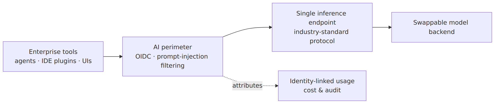

[← Back to portfolio](../README.md) · Reference Architectures

# Shared Enterprise Inference Platform

**AI Platform · Cost Governance · Security**

Reference architecture for a centrally managed AI inference platform — replacing per-team GPU sprawl with one governed endpoint designed for global use across demos, proofs-of-concept, and production workloads.

## The Enterprise Problem
Teams provision their own GPU instances. Most sit idle. Different teams run different model versions with different configurations — demos to customers stop being reproducible. Each ad-hoc setup has its own security posture.

## Architectural Approach
A single always-on inference endpoint, secured by an **OIDC perimeter** and protected by an **AI-specific firewall** (prompt injection, exfiltration, jailbreak detection).

Releases are guarded by automated capacity validation: a deployment is blocked before it lands if it would exceed safe GPU memory. Every request is attributed to a user at the perimeter, so usage is always cost-attributable and auditable.

## Design Outcomes
- **One endpoint, one security boundary, one cost centre** — replacing fragmented per-team setups
- **Democratised access to large models** — 30B+ parameter models reachable by any authorised user without per-team infrastructure overhead
- **AI-perimeter security** — prompt-injection and exfiltration filtering before requests consume GPU capacity
- **Per-user cost attribution** — usage tied to identity at the edge, enabling showback and chargeback
- **Backend independence** — model runtime can be swapped without client-side changes
- **Safe by default** — deployments blocked automatically if they would over-commit GPU memory

**Stack:** Enterprise AI platform · OIDC / SSO · AI security perimeter · GPU capacity governance · Kubernetes

---

← [Autonomous Research-Agent Platform](research-agent-platform.md) · [Home](../README.md) · [AI-Native Software Delivery Factory](software-factory.md) →
