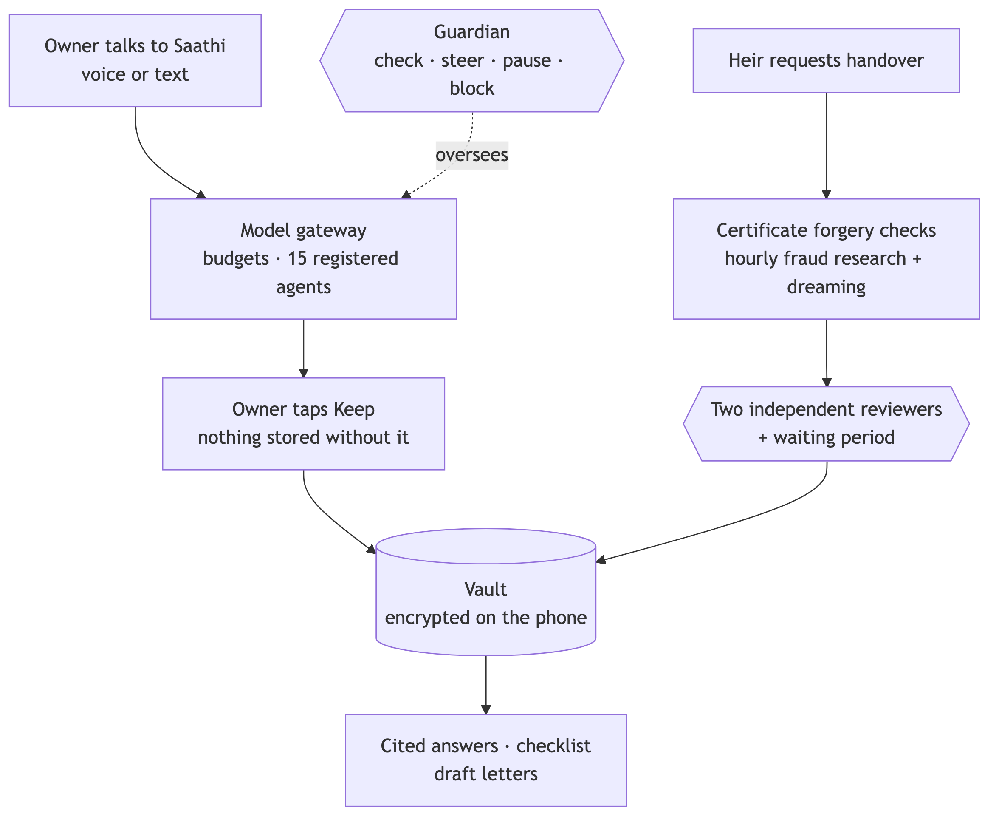

[← Back to portfolio](../README.md) · Built & Shipped

# Anvaya

**Governed Multi-Agent · Human Approval · Privacy by Design**

An AI companion, Saathi, that helps people record their accounts, nominees, wishes and stories — and hands them over safely to the person they chose. Built for the AI Builder Cup 2026 (BFSI track) on Gemini and Google Cloud.

## The Problem
When someone dies suddenly, their family often cannot find what they left. In India alone, ₹72,454 crore sits unclaimed in bank deposits. A handover system is also a prime target for fraud.

## What I Built
- **A guardian over every loop** — each AI step is a loop with a set autonomy level. The guardian can add a check, steer to a safer route, pause or block. It stops unsafe input, such as an OTP, before anything is stored.
- **One governed gateway** — 15 registered agents, each with its own models, budget and allowed actions, declared in policy files. Every model call passes through one gateway.
- **People decide** — nothing is kept without the owner's explicit "Keep". Nothing is released without two independent reviewers and a waiting period with one-tap cancel.
- **Fraud foresight** — certificates are checked for known signs of forgery. An agent researches new fraud every hour and imagines new attacks on the safeguards; a new tactic is added only when two independent sources confirm it.
- **A vault the operator cannot open** — secrets are encrypted on the owner's phone, for one chosen person.
- **Cited answers** — the family's assistant answers only from what was kept, and shows the source.

On a small synthetic evaluation set: 7 of 7 forged certificates flagged, 14 of 14 family answers cited the right source with no invented sources, and 803 automated tests.

**Stack:** Gemini (Flash-Lite, Live, TTS) · Google ADK · FastAPI · React · Cloud Run · Firestore · Cloud KMS

---

← [VeriClaims AI](vericlaims.md) · [Home](../README.md) · [Vouch](vouch.md) →
