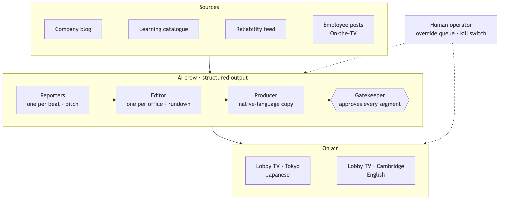
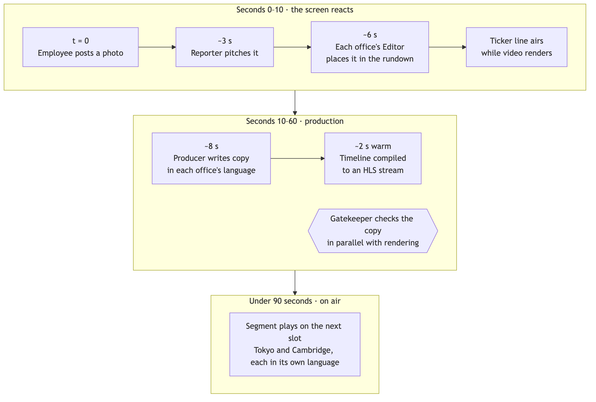

[← Back to portfolio](../README.md) · Built & Shipped

# InsideEdge

**Agentic Media · Multilingual · Human Override · Hackathon MVP**

An always-on lobby TV channel for every office of a global company with more than 60 offices. A small crew of AI agents composes the channel in real time, so each office gets its own cut, in its own language, with its own local emphasis. Any employee can put a photo or a shout-out on the screens, and it is typically on air, translated, in under 90 seconds.

The MVP runs two offices, Tokyo in Japanese and Cambridge in English. It was built in two days.

## The Problem
Large companies have many internal communication channels: blogs, documentation, learning catalogues, HR updates, all-hands meetings and chat. Each does its job well. What is missing is a *channel* in the broadcast sense — one editorial voice that pulls across all of them and helps every employee see the whole company. Meanwhile, the TVs in office lobbies mostly sit unused.

A signage playlist does not solve this. A channel has to be **authored**: someone has to decide what matters, for which office, in which language, and how it should look on a silent screen.

## Four design commitments

| Commitment | What it means in the system |
|---|---|
| **Lobby-first, not viewer-first** | The unit is the office, not the person. No login, no profiling and no attention tracking. |
| **Silent by default, captions always on** | A lobby TV is a silent medium, so every segment carries captions and readable title text. |
| **Continuous, not scheduled** | A rolling rundown that replans when new material arrives. Every moment is prime time for someone. |
| **Authored, not shuffled** | Agents compose segments. A blog post becomes a 45-second title card; an employee's photo becomes a full-screen moment with a broadcast-style caption. |

## The crew

Every agent is a plain Python function that calls Claude with a typed output schema. No agent framework is involved, which keeps the pipeline deterministic and easy to debug.

| Role | Job | How it decides |
|---|---|---|
| **Reporter** (one per beat) | Watches its sources and pitches stories: angle, key points, length and priority | One structured call per new item. Low effort setting, because triage is simple |
| **Editor** (one per office) | Owns that office's rolling rundown and replans when a pitch, override or finished segment arrives | One structured call ranks and places. **Hard rules run in code, not in the prompt** — pins first, no duplicates, at most two segments per beat |
| **Producer** | Writes broadcast copy in the office's own language, picks a template, and drives the video composition | Two calls: copy, then template. Copy is written natively in each language, not translated |
| **Gatekeeper** | Approves every segment before it can air | A checklist call: unreleased product names, customer names, tone and sensitive content. Every rejection is logged with its reason |
| **Caretaker** | Keeps the channel healthy | Mostly code: bumpers between beats, pacing rules, and evergreen fill when the rundown runs thin |
| **Operator** (a person) | Has the final say | An override queue pins a message to every screen in seconds; a kill switch takes any segment down in seconds |

Each agent keeps its role prompt and skills as fixed, cached text, and its working memory as a separate, editable file. Effort is set per role: low for triage and the safety gate, high for rundown decisions and copywriting.

## From a phone to every lobby in under 90 seconds

Two choices keep the 90-second promise:

- **The screen reacts first.** A ticker line goes on air as soon as the Editors place the story, while the video still renders. Viewers see the channel respond within seconds.
- **The safety check runs in parallel.** The Gatekeeper checks the script and copy, not the finished video, so it never adds to the render time.

## Key engineering decisions

- **Plain loops, not an agent framework.** I evaluated the video platform's own agent framework. Its control flow is chosen by the model per chat request — the opposite of what a 24/7 broadcast pipeline needs. The crew stays a deterministic, event-driven state machine; the framework is useful only as a reference and as an optional editing console beside the pipeline.
- **A swappable video layer.** One thin adapter exposes a small set of verbs — ingest, compose, dub, generate and export — and nothing else imports the video SDK. A fallback stack is a second implementation of those verbs, not a rewrite.
- **A client-side sequencer as the TV.** The video platform renders discrete segments, but a channel must never stop. The player page asks for the next segment, prefetches it and cross-fades. The ticker, captions, watermark and spotlight cards are an HTML layer, not burned into the video, so the look can change at zero re-render cost.
- **Observable by construction.** Each stage — material, pitch, job, segment, rundown — is a table with a status field. The master-control dashboard reads those tables directly, so the whole pipeline can be inspected with a query.
- **Schema-valid by guarantee.** Every agent decision is a typed model enforced by the API, so the pipeline has no output-parsing failure paths.

## What the spike measured

I ran a live spike against the video platform on day one, and changed the design where the evidence said so:

- **A segment compiles in about 2 seconds warm** (44 seconds cold, once). The stream is playable immediately after compiling, so the sequencer can prefetch safely.
- **The photo path never waits on generative jobs.** Only the synchronous compile path sits on the critical path, so the 90-second budget is safer than first assumed.
- **No font on the render farm could draw Japanese.** Three candidate fonts all failed silently. The system now detects CJK text, skips burning it into the video, and renders it in the HTML overlay instead.
- **The first planned office language had no dubbing support.** I moved the demo office to one with native support, rather than adding a third-party speech dependency.

## Next: daily highlight shows (designed, not built)

The same crew gains a nightly deliverable. A new **Showrunner** agent reviews everything pitched that day and cuts one 90–120-second episode per show, per office language: open with the strongest moment, vary the beats, place a human moment about two-thirds in, and close looking forward. Real clips are used where footage exists, cards where it does not.

Two shows share the same machine with different charters — an internal daily recap, and an external briefing on the few things that changed in AI that day. Running one crew against an internal and an external charter is the argument that **the pattern is the product**. An episode is stored as an ordinary pinned segment with a cue sheet, so playout, override, kill and the programme guide all work on it with no new tables.

**Stack:** Python · Claude (structured output, adaptive thinking, prompt caching) · FastAPI · Pydantic · SQLite · VideoDB (timeline composition, dubbing, HLS) · hls.js

---

← [Usra](usra.md) · [Home](../README.md)
