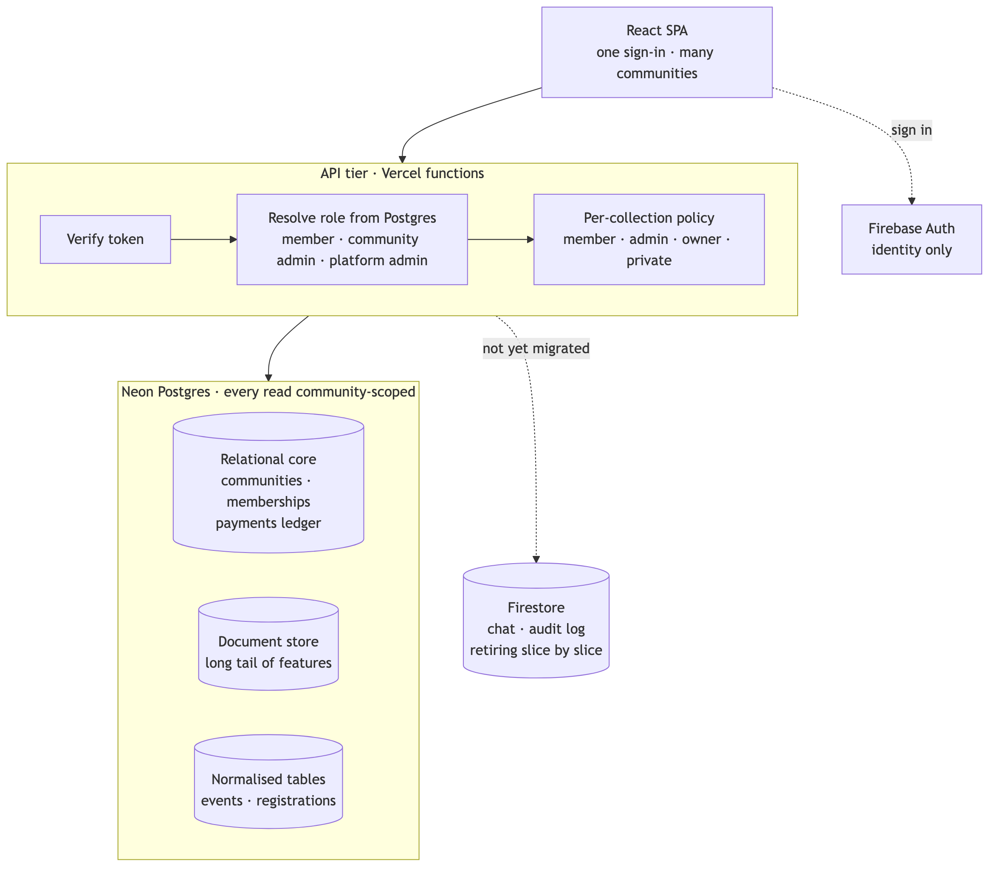

[← Back to portfolio](../README.md) · Built & Shipped

# TribeRoots

**Multi-Tenant Platform · Server-Side RBAC · Live Data Migration**

A community operating system: one platform that runs many private communities — schools, faith and cultural groups, residents' associations, alumni networks, clubs, events and merchant networks. Each community turns on only the features it needs: events and ticketing, news, chat, polls, secret-ballot elections, listings, a directory, partner perks, homework, and feedback.

## The Problem
Small communities run on a patchwork of chat groups, spreadsheets and payment screenshots. A platform that serves all of them needs strict tenant isolation, three levels of administration, and room to grow — without rewriting the app every time.

## What I Built
- **Three-tier roles, enforced on the server** — member, community admin (scoped to the features that community enabled), and platform admin. The API verifies the identity token, resolves the role from Postgres, then applies a per-collection policy. Roles are never just hidden in the UI.
- **Strangler migration, Firestore → Neon Postgres** — moved entity by entity behind flags, never a big-bang cutover. Every reader and writer of a collection moved together, the app stayed green throughout, and Firebase now handles identity only.
- **Two data shapes on one database** — a normalised relational core (communities, memberships, payments) plus a generic document store for the long tail of features. Hot entities such as events graduate to their own tables behind a repository router, with no change to the API shape.
- **Payments ledger and signed tickets** — pay-by-proof with integer minor units and a status state machine; admin confirmation is atomic and idempotent, and issues HMAC-signed tickets that the QR scanner verifies.
- **Audit and assurance** — every admin change goes to an audit log; a code-cited security audit of the access-control layer drives the hardening backlog.
- **Safe testing** — Playwright characterisation tests against the Firebase emulators, unit tests on framework-free domain logic, and isolated Neon branches for dev and CI.

**Stack:** React 19 · Vite · TypeScript · Tailwind · Firebase Auth & Storage · Vercel Functions · Neon Postgres (raw SQL) · Playwright · GitHub Actions · i18next

---

← [Hackathon Judging Platform](hackathon-judging.md) · [Home](../README.md) · [Usra](usra.md) →
