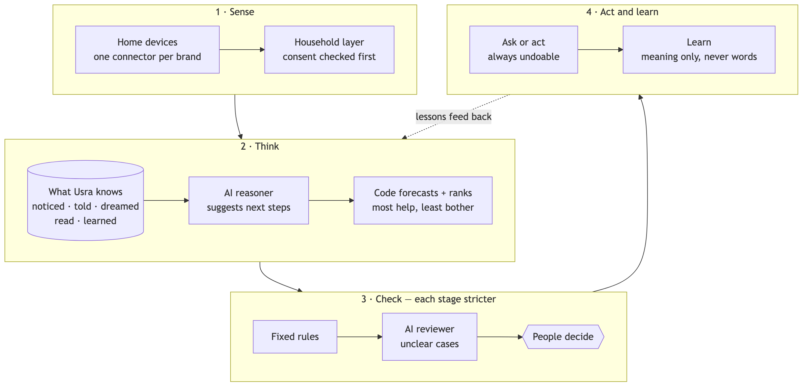

[← Back to portfolio](../README.md) · Built & Shipped

# Usra

**Household Digital Twin · Privacy by Design · Contract-First · Prototype**

A digital twin of the household for family wellbeing. It senses through devices the home already has, shows how the whole family is doing as one living picture with no individual scores, and suggests small, well-timed steps back to balance. Entry to the Future Health Digital Innovation Challenge 2026.

## The Problem
Health apps look after one person at a time, but families share sleep, meals, stress and care. When one person struggles, everyone feels it — and the obvious fix, more monitoring, is exactly what families do not want in their home.

## What I Designed and Built
- **A fenced AI reasoner** — an AI suggests next steps, but code does the forecasting and ranking, and every idea passes three checks: fixed rules, then an AI reviewer for unclear cases, then people. Each check can only be stricter than the one before. The AI's own ideas stay "ideas" until the home's own data confirms them.
- **Five clean layers** — device connectors (one per brand), a household layer that checks consent before any reading is used, the brain, reports, and screens. No screen can skip the privacy check.
- **Privacy as architecture** — no cameras, no recordings, no location tracking; sound is measured only as "loud" or "quiet" on the device. Each person's data is locked with their own key, so a teenager's space stays private even from parents. Conversations keep the meaning, never the words.
- **Safety at three speeds** — safety checks and "Usra, stop" work at once, even offline; suggestions and two-week trials run over days; reflection ("dreaming") and the monthly family note run at night.
- **Contract-first interfaces** — every message between modules is a versioned JSON Schema with an owner and privacy level for each field. Tests check that the running services keep to the contracts, and every conflict is settled in a written decision record.
- **A live synthetic society** — the "Usra City" prototype runs many synthetic households through the engine on a schedule, with a control centre and map view, to show the system working at population scale.

**Stack:** Node.js 24 · Claude Opus 5.5 (Anthropic SDK) · Nitro · Vercel Workflow & Functions · Neon Postgres · JSON Schema 2020-12 (Ajv) · OpenAPI 3.1 · MapLibre GL · deck.gl

---

← [TribeRoots](triberoots.md) · [Home](../README.md) · [InsideEdge](insidedge.md) →
