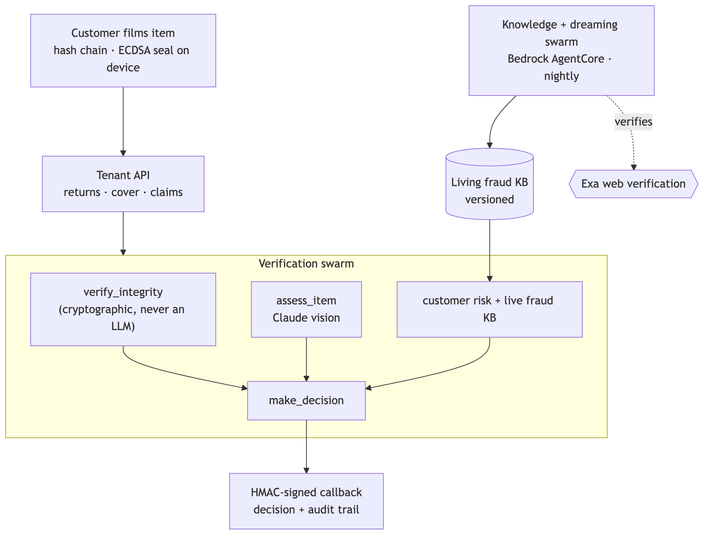

[← Back to portfolio](../README.md) · Built & Shipped

# VeriClaims AI

**Agentic AI · Tamper-Evidence · Multi-Tenant API**

Verification-as-a-service for e-commerce returns and insurance cover and claims. A customer films the item; an agent swarm proves the video is genuine, checks it is the right product, and grades its condition — before a refund is paid, a policy is issued, or a claim is settled.

## The Problem
Return and claims fraud — empty-box returns, swapped serials, "arrived damaged" — persists because money is approved on trust, before anyone checks the item.

## What I Built
- **On-device tamper-evidence** — every video frame is folded into a SHA-256 hash chain seeded by a single-use server nonce, and the root is signed with ECDSA P-256 at capture. The server recomputes and verifies it; the client's own "verified" claim is never trusted.
- **Verification swarm** — an LLM reasoning loop over six tools (integrity, customer risk, fraud KB, Claude vision, decision, courier booking), durable on Vercel Workflows. Tools act on real server-side data, not prompt text.
- **Deterministic floor** — integrity is always a cryptographic verdict, never an LLM judgement. Skipped agent steps are backfilled deterministically, so the agentic result is never worse than the rule-based engine.
- **Living fraud knowledge base** — a second swarm on AWS Bedrock AgentCore researches fraud tactics nightly and "dreams" new attack scenarios, verifying each one against the web (Exa) before it enters a versioned knowledge base.
- **Tenant integration** — one REST API, idempotent requests, and HMAC-signed callbacks carrying the decision, the full audit trail and the policy clause behind it.

**Stack:** Next.js · Vercel Workflows · Claude vision · AWS Bedrock AgentCore · DynamoDB single-table · AWS CDK

---

[Home](../README.md) · [Anvaya](anvaya.md) →
