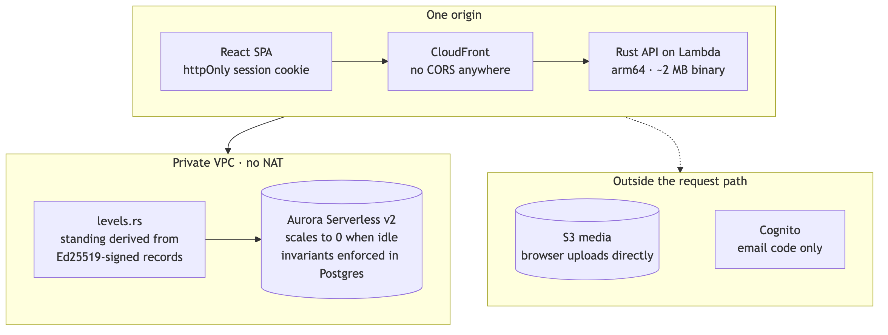

[← Back to portfolio](../README.md) · Built & Shipped

# Vouch

**Identity & Trust · Database-Enforced Invariants · Serverless AWS**

A professional network where standing is derived from work records that other people signed — not from self-asserted profiles or star ratings.

## The Problem
A profile on a professional network is a claim about work, not proof of it. Ratings can be gamed, and nothing stops a seller from vouching for themselves.

## What I Built
- **Invariants in the database, not the code** — levels are a view over records, never a stored column. A composite foreign key makes it impossible for a seller to sign their own acceptance. `UPDATE` and `DELETE` are revoked on every record table, so a handler bug cannot rewrite history.
- **Verifiable records** — each record is canonical JSON signed with Ed25519. Verification checks whether the key was bound *when the record was written*, so keys rotate without destroying history, and a compromised key invalidates everything it ever signed.
- **Honest custody** — every record states who signed it (the platform on the user's behalf, a device, or the user's own key), so a record never claims more than it proves.
- **Cost-shaped serverless design** — a ~2 MB Rust API on Lambda behind one CloudFront origin, Aurora Serverless v2 that scales to zero, no NAT gateway, and uploads that go straight from browser to S3.
- **Specification-first testing** — 57 scenarios written against the concept paper, not the code, found 21 defects. The suite now passes 107 tests; features not yet built are listed as ignored specs, never quietly dropped.

**Stack:** Rust (axum, sqlx) · PostgreSQL · React · AWS Lambda · Aurora Serverless v2 · Cognito · AWS CDK

---

← [Anvaya](anvaya.md) · [Home](../README.md) · [Hackathon Judging Platform](hackathon-judging.md) →
